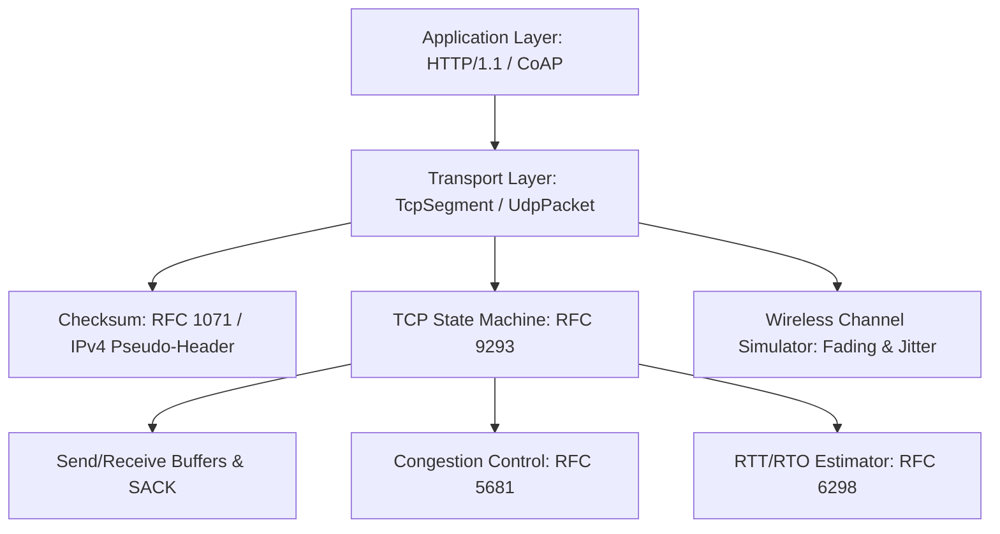

# System Architecture & Codebase Logic Documentation

This document provides a block-by-block, file-by-file breakdown of the logic implemented in **`iot-transport-stack`**. It serves as an engineering reference for the IIIT Sri City M.Tech IoT Wireless Communication course presentation.

---

## 1. Directory Tree & Module Map

```
src/
├── proto/              # Protocol Data Unit (PDU) encoders, decoders & RFC checkers
│   ├── checksum.rs     # RFC 1071 16-bit Internet Checksum + IPv4 pseudo-header sum
│   ├── ipv4.rs         # IPv4 header serializer/deserializer
│   ├── udp.rs          # RFC 768 UDP datagram encoding, checksum & parsing
│   ├── tcp_flags.rs    # RFC 9293 8-bit control flags bitmask helper
│   ├── tcp_options.rs  # RFC 9293, 7323 & 2018 TCP Options parser/serializer
│   ├── tcp.rs          # RFC 9293 TCP Segment wire serialization & checksum logic
│   ├── http.rs         # RFC 9112 HTTP/1.1 REST & RFC 7252 CoAP message formats
│   └── mod.rs          # Protocol submodule re-exports
├── tcp/                # TCP State Machine, Transmission Control Block & Dynamics
│   ├── state.rs        # 11-State Finite State Machine (FSM) enum & transitions
│   ├── rtt.rs          # RFC 6298 Jacobson/Karn RTT & RTO exponential backoff
│   ├── congestion.rs   # RFC 5681 Slow Start, Congestion Avoidance, Fast Retransmit
│   ├── buffer.rs       # Sliding window send/receive ring buffers & SACK accounting
│   ├── connection.rs   # Transmission Control Block (TCB) coordinator & packet dispatch
│   └── mod.rs          # TCP submodule re-exports
├── wireless/           # Physical/Link Layer Wireless Simulation
│   ├── channel.rs      # Stochastic link model (loss, jitter, latency, bit corruption)
│   └── mod.rs          # Wireless submodule re-exports
└── main.rs             # Multi-stage live validation & presentation runner
```

---

## 2. File-by-File Logic & Block Breakdown

### `src/proto/checksum.rs`
**RFC Reference:** RFC 1071, RFC 768, RFC 9293

- **Block 1: `calculate_checksum(data: &[u8]) -> u16`**
  - **Logic:** Implements the canonical 16-bit one's complement addition of 16-bit words.
  - **Odd-byte handling:** When the input slice has an odd length, it pads the trailing byte with `0x00` on the least significant 8 bits to form a 16-bit word.
  - **Carry bit folding:** Continuously extracts the high 16 bits of the accumulated 32-bit sum `(sum >> 16)` and adds it back to the low 16 bits until no overflow remains. Finally, bitwise inverts `(!sum as u16)` to return the one's complement result.
- **Block 2: `ipv4_pseudo_header_checksum(src_ip, dst_ip, protocol, length) -> u32`**
  - **Logic:** Computes the 12-byte IPv4 pseudo-header sum mandated for TCP and UDP checksum validation, preventing segments from being misdelivered across IP endpoints.

---

### `src/proto/ipv4.rs`
**RFC Reference:** RFC 791

- **Block 1: `Ipv4Header` Struct**
  - **Fields:** `version_ihl` (0x45 = IPv4, 20 bytes), `dscp_ecn`, `total_length`, `identification`, `flags_fragment_offset`, `ttl`, `protocol` (6 for TCP, 17 for UDP), `checksum`, `src_ip`, and `dst_ip`.
- **Block 2: `new()` and `calculate_header_checksum()`**
  - **Logic:** Prepares a default 20-byte IP header with `Don't Fragment (0x4000)` and `TTL = 64`. Computes the header checksum with the checksum field zeroed out, then places the computed checksum at bytes `10..12`.
- **Block 3: `serialize_into()` and `parse()`**
  - **Logic:** Fast, zero-copy buffer slicing converting between network big-endian bytes and native struct fields. Validates minimum length ($\ge 20$ bytes) and IP version nibble `(version_ihl >> 4) == 4`.

---

### `src/proto/udp.rs`
**RFC Reference:** RFC 768

- **Block 1: `UdpPacket` Struct**
  - **Fields:** `src_port`, `dst_port`, `length` (8-byte header + payload), `checksum`, and `payload` vector.
- **Block 2: `compute_checksum()`**
  - **Logic:** Serializes the 8-byte UDP header with checksum set to `0`, appends the payload, accumulates words alongside the IPv4 pseudo-header sum, and inverts.
  - **RFC 768 Rule:** If the calculated checksum evaluates to `0x0000`, it is transmitted as `0xFFFF` (all ones), as all zeros indicates checksum computation was disabled.
- **Block 3: `serialize()` & `parse()`**
  - **Logic:** Byte-level encoder and decoder with boundary checks verifying that `buf.len() >= length` and `length >= 8`.

---

### `src/proto/tcp_flags.rs`
**RFC Reference:** RFC 9293 (Section 3.1) & RFC 3168

- **Block 1: `TcpFlags(pub u8)` Newtype Pattern**
  - **Bit Constants:**
    - `FIN (0x01)`: Connection teardown indicator.
    - `SYN (0x02)`: Synchronize sequence numbers.
    - `RST (0x04)`: Reset connection.
    - `PSH (0x08)`: Push function (flush to application).
    - `ACK (0x10)`: Acknowledgment field significance.
    - `URG (0x20)`: Urgent pointer field significance.
    - `ECE (0x40)` & `CWR (0x80)`: Explicit Congestion Notification flags.
- **Block 2: Helper predicates (`syn()`, `ack()`, `fin()`, etc.)**
  - **Logic:** Bitwise mask checks `(self.0 & FLAG) != 0` and custom formatting displaying active flags (e.g. `[SYN|ACK]`).

---

### `src/proto/tcp_options.rs`
**RFC Reference:** RFC 9293, RFC 7323, RFC 2018

- **Block 1: `TcpOption` Enum**
  - Variants: `EndOfOptionList (Kind 0)`, `NoOperation (Kind 1)`, `MaximumSegmentSize (Kind 2, Len 4)`, `WindowScale (Kind 3, Len 3)`, `SackPermitted (Kind 4, Len 2)`, `Sack(Vec<(u32, u32)>) (Kind 5)`, `Timestamp (Kind 8)`.
- **Block 2: `serialize(&self) -> Vec<u8>`**
  - Encodes each option into TLV format (`[Kind, Length, Value...]`). For SACK blocks, writes left-edge and right-edge 32-bit sequence pairs.
- **Block 3: `parse_all(buf: &[u8]) -> Result<Vec<Self>, &'static str>`**
  - Reads TLV streams, handling single-byte options (0 and 1) without length fields and multi-byte options according to their length byte.

---

### `src/proto/tcp.rs`
**RFC Reference:** RFC 9293

- **Block 1: `TcpSegment` Wire Structure**
  - Contains source/dest ports, 32-bit sequence and ACK numbers, 4-bit data offset, flags, 16-bit window size, checksum, urgent pointer, options, and payload.
- **Block 2: `with_options()` and Data Offset Computation**
  - Computes header length including options, pads to 32-bit (4-byte) boundaries, and updates the `data_offset` nibble `(header_bytes / 4)`.
- **Block 3: `compute_checksum()`**
  - Serializes the TCP segment with zeroed checksum, prepends the IPv4 pseudo-header (protocol 6), and calculates the RFC 1071 one's complement sum.
- **Block 4: `parse()`**
  - Extracts 20-byte base fields, reads options between byte 20 and `data_offset * 4`, strips padding options, and extracts the payload.

---

### `src/proto/http.rs`
**RFC Reference:** RFC 9112 (HTTP/1.1) & RFC 7252 (CoAP)

- **Block 1: `HttpRequest` & `HttpResponse`**
  - **Logic:** Provides structured HTTP message framing. `serialize()` generates RFC-compliant `\r\n` delimited headers (`Host`, `Content-Length`, `Content-Type`) and body. `parse()` parses HTTP request lines and header maps.
- **Block 2: `CoapMessage` (Constrained Application Protocol)**
  - **Logic:** Implements binary 4-byte CoAP headers `[Ver|Type|TKL, Code, MessageID, Token, 0xFF, Payload]` for ultra-low-overhead IoT sensor transmissions over UDP.

---

### `src/tcp/state.rs`
**RFC Reference:** RFC 9293 (Section 3.3.2)

- **Block 1: `TcpState` Enum**
  - Encapsulates the complete 11 TCP connection states: `Closed`, `Listen`, `SynSent`, `SynReceived`, `Established`, `FinWait1`, `FinWait2`, `CloseWait`, `Closing`, `LastAck`, `TimeWait`.
- **Block 2: State Inspection Methods**
  - `is_active()` and `is_connected()` check if the endpoint can accept or transmit data.

---

### `src/tcp/rtt.rs`
**RFC Reference:** RFC 6298 & Karn's Algorithm

- **Block 1: `RttEstimator` State**
  - Tracks Smoothed RTT ($SRTT$), RTT Variation ($RTTVAR$), and Retransmission Timeout ($RTO$).
- **Block 2: `update_rtt(sample: Duration)`**
  - First measurement: $SRTT = R$, $RTTVAR = R / 2$, $RTO = SRTT + 4 \times RTTVAR$.
  - Subsequent measurements:
    $$RTTVAR = (1 - \beta) \times RTTVAR + \beta \times |SRTT - R| \quad (\beta = 0.25)$$
    $$SRTT = (1 - \alpha) \times SRTT + \alpha \times R \quad (\alpha = 0.125)$$
    $$RTO = SRTT + 4 \times RTTVAR$$
  - Clamped between `min_rto_ms` (200ms) and `max_rto_ms` (60,000ms).
- **Block 3: `on_timeout_backoff()`**
  - Implements Karn's algorithm: doubles $RTO$ ($RTO = RTO \times 2$) upon segment timeout.

---

### `src/tcp/congestion.rs`
**RFC Reference:** RFC 5681

- **Block 1: `CongestionControl` State**
  - Tracks Congestion Window ($cwnd$), Slow Start Threshold ($ssthresh$), Sender Maximum Segment Size ($SMSS$), and duplicate ACK counter.
- **Block 2: `on_ack_received(ack_num: u32)`**
  - **Duplicate ACK:** If 3 consecutive duplicate ACKs are observed, triggers Fast Retransmit:
    $$ssthresh = \max(cwnd / 2, 2 \times SMSS), \quad cwnd = ssthresh + 3 \times SMSS$$
  - **New ACK in Slow Start:** Increases $cwnd$ by $1 \times SMSS$ per ACK (exponential growth).
  - **New ACK in Congestion Avoidance:** Increases $cwnd$ by $(SMSS \times SMSS) / cwnd$ per ACK (linear growth).
- **Block 3: `on_timeout()`**
  - When retransmission timeout expires, drops $ssthresh = \max(cwnd / 2, 2 \times SMSS)$, sets $cwnd = 1 \times SMSS$, and resets phase to `SlowStart`.

---

### `src/tcp/buffer.rs`
**RFC Reference:** RFC 9293 & RFC 2018 (SACK)

- **Block 1: `SendBuffer`**
  - Maintains `unacked: BTreeMap<u32, Vec<u8>>` mapping sequence numbers to in-flight data.
  - `acknowledge_up_to(ack_seq)` purges all segments fully acknowledged by the receiver.
- **Block 2: `RecvBuffer`**
  - Maintains in-order assembled payload `stream` and out-of-order storage `out_of_order: BTreeMap<u32, Vec<u8>>`.
  - `insert_segment()` stitches contiguous sequence numbers into `stream` while queuing discontiguous blocks.
  - `get_sack_blocks()` returns up to 4 SACK blocks `(left_edge, right_edge)` notifying the sender which segments were received out-of-order.

---

### `src/tcp/connection.rs`
**RFC Reference:** RFC 9293 (Transmission Control Block - TCB)

- **Block 1: `TcpConnection` Struct**
  - Encapsulates all state variables: local/remote IP and ports, send sequence state (`snd_una`, `snd_nxt`, `snd_wnd`), receive sequence state (`rcv_nxt`, `rcv_wnd`), state enum, buffers, RTT estimator, and congestion controller.
- **Block 2: Segment Builders**
  - `build_syn()`: Builds initial SYN, sets MSS & SACK-permitted options, increments `snd_nxt`, transitions to `SynSent`.
  - `build_syn_ack()`: Responds to incoming SYN, increments `snd_nxt`, transitions to `SynReceived`.
  - `build_ack()`: Constructs standalone ACK, attaches active SACK blocks from `RecvBuffer`.
  - `build_data_segment()`: Encapsulates payload, records sent timestamp for RTT tracking, and marks data as unacknowledged in `SendBuffer`.
  - `build_fin()`: Initiates graceful teardown, increments `snd_nxt`, moves to `FinWait1` or `LastAck`.
- **Block 3: `handle_incoming(seg: &TcpSegment)` State Dispatcher**
  - Executes RFC 9293 state transition matrix:
    - `Listen` + `SYN` $\rightarrow$ replies with `SYN-ACK`.
    - `SynSent` + `SYN-ACK` $\rightarrow$ verifies ACK, marks `Established`, replies with `ACK`.
    - `Established` $\rightarrow$ processes incoming ACK (updates RTT and $cwnd$, flushes send buffer) and incoming payload (queues into receive buffer and generates ACK reply). On `FIN`, transitions to `CloseWait`.
    - `FinWait1` / `FinWait2` $\rightarrow$ transitions to `TimeWait` upon receiving peer's `FIN`.

---

### `src/wireless/channel.rs`
**Course Context:** Wireless Channel Modeling for IoT

- **Block 1: `WirelessChannel` Struct**
  - Parameters: `packet_loss_rate` ($0.0 - 1.0$), `base_latency_ms`, `jitter_ms`, and `bit_error_rate`.
- **Block 2: Channel Presets**
  - `zigbee_802154()`: 12% loss rate, 25ms latency, 10ms jitter (modeling 2.4 GHz ISM interference).
  - `lora_fading()`: 25% loss rate, 150ms latency, 50ms jitter (modeling deep Rayleigh fading).
- **Block 3: `transmit(&self, packet: &[u8]) -> Option<Vec<u8>>`**
  - **Fading/Drop Step:** Evaluates Bernoulli trial with probability $P_{\text{loss}}$; drops packet if true.
  - **Delay Step:** Computes latency $T = \text{base\_latency} \pm \text{jitter}$ and delays thread.
  - **Bit Corruption Step:** Inverts random bits with probability $P_{\text{BER}}$ to verify receiver checksum rejection.

---

### `src/main.rs`
**Course Presentation Runner**

- **Block 1: `print_banner()`**: Displays course title and RFC standards.
- **Block 2: `demo_rfc_compliance()`**: Encodes and parses raw UDP and TCP segments, verifying wire checksums.
- **Block 3: `demo_three_way_handshake()`**: Demonstrates client/server connection establishment step-by-step.
- **Block 4: `demo_http_over_tcp()`**: Demonstrates full Layer 7 HTTP/1.1 POST telemetry transmission over custom TCP, followed by response processing and FIN/ACK teardown.
- **Block 5: `demo_wireless_comparison()`**: Injects 25% wireless channel loss to compare unrecoverable UDP/CoAP drops against TCP/HTTP self-healing retransmissions and congestion backoff.
- **Block 6: `main()`**: Orchestrates the demonstration sequence.

---

## 3. Summary of Protocol Inter-Dependencies



This modular separation isolates transport protocol logic from the transmission medium, allowing direct evaluation of wireless channel impairment effects on transport layer dynamics.
